# My AI Pipeline

See `guide/04-ai-pipeline.md` for what each part needs.

> **Status: Day 1 draft.** This is the plan. I update it as I go and finish it on Day 5 with what I actually did.

## Part 1: The Pipeline Diagram

```mermaid
flowchart TB
    S1["1 Requirements<br/>AI: reads transcript, email, note and sheets; drafts the audit, questions and criteria<br/>Me: check every finding against the sources; decide the open questions<br/>Tool: Claude Code"] --> C1{"Check: matches the stage's Done when in guide 05; every finding traced to a source"}
    C1 --> S2["2 Planning<br/>AI: drafts stories, tasks and time guesses<br/>Me: order the tasks, pick the first slice, name the risks<br/>Tool: Claude Code"]
    S2 --> C2{"Check: matches Done when; every must-have maps to a task"}
    C2 --> S3["3 Design<br/>AI: drafts diagrams, data model and screens<br/>Me: choose the design; get feedback as Dana or Sam would<br/>Tool: Claude Code, Claude Design"]
    S3 --> C3{"Check: matches Done when; data model covers every requirement"}
    C3 --> S4["4 Build<br/>AI: proposes a plan per task, then writes the code<br/>Me: approve each plan; run the app; correct mistakes<br/>Tool: Claude Code"]
    S4 --> C4{"Check: does what the task said; app runs; I can explain the code"}
    C4 --> S5["5 Testing<br/>AI: drafts the tests<br/>Me: read what each test checks; break the code once to prove it; do UAT<br/>Tool: Claude Code"]
    S5 --> C5{"Check: matches Done when; all tests pass with one command"}
    C5 --> S6["6 Deployment<br/>AI: drafts the workflow, .env.example and run steps<br/>Me: confirm no secrets; get the check green<br/>Tool: Claude Code, GitHub Actions"]
    S6 --> C6{"Check: matches Done when; green check on the latest commit"}
    C6 --> S7["7 Maintenance<br/>AI: helps reproduce the bug and propose a fix<br/>Me: write the failing test first; approve the fix<br/>Tool: Claude Code"]
    S7 --> C7{"Check: matches Done when; failing test now passes"}
```

**How I check the AI's work:** at every checkpoint I compare what it produced with what the stage asks for (the "Done when" in `guide/05-build.md` and the headings in the stage document), and check it actually does what it is supposed to do.

## Part 2: Tools

| Tool | Stages | Why |
|---|---|---|
| Claude Code | All seven | Reads the repository, drafts documents, writes code and tests, commits. Works from my phone through the cloud session |
| Claude chat (`teach-me`) | Before each stage | Learning each stage hands-on before I do it, without mixing that into the project session |
| Claude Design (planned) | 3 Design | Designing the dashboard screens, as the brief asks |
| GitHub Actions | 6 Deployment | Runs the tests automatically on every push |

## Part 3: Context

- What is in my `CLAUDE.md`: what the app is, the stack, my working rules (plan first, one task at a time, explain every change, no new dependencies without asking) and the standards (folders, made-up data, no customer names on screen, a test for every piece of logic).
- A lesson I added after the AI got something wrong: none yet. Added when it happens.
- When I start a fresh session: learning (`teach-me`) always happens in a separate Claude chat, so it does not fill the project session. Planned: a fresh Claude Code session per stage.
- What never goes in context: secrets and keys, real personal data, and the brief itself outside this private repository (it is under NDA).

## Part 4: Token Use

| Stage | Rough usage | Notes |
|---|---|---|
| 1 Requirements | | |
| 2 Planning | | |
| 3 Design | | |
| 4 Build | | |
| 5 Testing | | |
| 6 Deployment | | |
| 7 Maintenance | | |

**My habits (planned):**

1. Learning in a separate chat, not the project session.
2. Plan before code, so the agent does not write things I then throw away.
3. Short instructions that name the exact files.

**One before and after:**

- Task:
- Before (usage, and what I did):
- After (usage, and what I changed):

## Part 5: What Changed

[Filled in on Day 5: this Day 1 draft compared with the final version]
